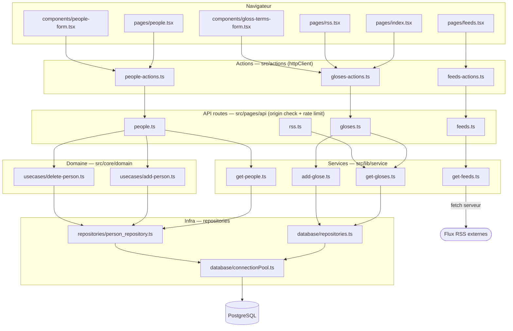

# Architecture de code-gloss

## Écarts au modèle cible

- Le repository des gloses est dans `infra/database/repositories.ts`, celui des personnes dans `infra/repositories/person_repository.ts`.
- La route `people.ts` passe par des usecases du domaine (`add-person`, `delete-person`), alors que les autres routes appellent directement les services.
