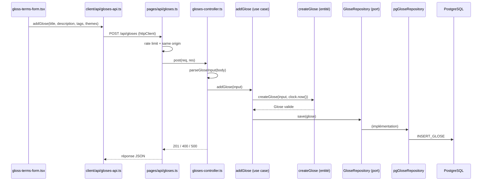

# Architecture cible — code-gloss

> 24 novembre 2026 · exemple d'architecture cible selon les principes de la Clean Architecture · voir aussi [l'architecture actuelle](architecture.md) et [le plan de modifications](plan.md) (point 10)

Ce document propose une organisation cible du code. Le métier (gloses, personnes, flux) ne dépend plus de Next.js, de `pg` ni de `fetch`. Les détails techniques se branchent sur le métier via des interfaces (ports).

Aujourd'hui :

- les services (`src/lib/service/add-glose.ts`, `get-gloses.ts`) importent directement `@/infra/database/repositories` : le métier dépend de l'infrastructure ;
- les usecases des personnes (`src/core/domain/usecases/add-person.ts`) injectent déjà leur repository : c'est l'embryon du pattern cible ;
- le type `Glose` est dupliqué (`add-glose.ts` et `GloseComplete` dans le domaine) ;
- les repositories sont rangés à deux endroits (`infra/database/` et `infra/repositories/`) ;
- les routes API contiennent de la logique (parsing du body, vérification d'origine, construction de la réponse).

## La règle de dépendance

Les dépendances pointent **uniquement vers l'intérieur**. Une couche intérieure ne connaît jamais le nom d'un élément d'une couche extérieure.

```mermaid
flowchart LR
    subgraph F["4 · Frameworks & drivers"]
        direction TB
        Next["Next.js (pages, api)"]
        React["React (components)"]
        PG["pg / PostgreSQL"]
        HTTP["fetch / flux RSS"]
    end

    subgraph A["3 · Adaptateurs"]
        direction TB
        Ctrl["Contrôleurs API"]
        Pres["Presenters (DTO)"]
        Repo["Repositories Postgres"]
        Reader["Lecteur RSS HTTP"]
    end

    subgraph U["2 · Use cases"]
        direction TB
        UC["add-glose, list-gloses,<br/>add-person, read-feed…"]
        Ports["Ports (interfaces)"]
    end

    subgraph E["1 · Entités"]
        Dom["Glose, Theme, Person, Feed"]
    end

    F --> A --> U --> E
```



| Couche          | Responsabilité                                                                   | Peut dépendre de   | Exemples                                         |
| --------------- | -------------------------------------------------------------------------------- | ------------------ | ------------------------------------------------ |
| 1 · Entités     | Règles métier pures, invariants, validation                                      | rien               | `Glose.ts`, `Theme.ts`, `Person.ts`              |
| 2 · Use cases   | Orchestration d'une intention utilisateur ; déclare les ports dont elle a besoin | Entités            | `add-glose.ts`, `ports/glose-repository.ts`      |
| 3 · Adaptateurs | Traduction entre le monde extérieur et les use cases                             | Use cases, Entités | `gloses-controller.ts`, `pg-glose-repository.ts` |
| 4 · Frameworks  | Next.js, React, `pg`, `fetch` ; câblage des dépendances                          | tout               | `pages/api/gloses.ts`, `connection-pool.ts`      |

## Arborescence cible

```
src/
  core/                          # aucun import de next, pg, react ou fetch
    domain/
      glose/      Glose.ts, Theme.ts, glose-errors.ts
      person/     Person.ts
      feed/       Feed.ts, parse-feed.ts
    ports/                       # interfaces implémentées à l'extérieur
      glose-repository.ts
      person-repository.ts
      feed-reader.ts
      clock.ts
    usecases/
      gloses/     add-glose.ts, list-gloses.ts, filter-gloses-by-themes.ts
      people/     add-person.ts, delete-person.ts, list-people.ts
      feeds/      read-feed.ts

  adapters/
    api/                         # contrôleurs : entrée HTTP → use case → réponse
      gloses-controller.ts
      people-controller.ts
      feeds-controller.ts
    presenters/                  # entité → DTO JSON
      glose-presenter.ts

  infrastructure/
    postgres/     connection-pool.ts, sql-queries.ts,
                  pg-glose-repository.ts, pg-person-repository.ts
    rss/          http-feed-reader.ts      # garde SSRF, timeout, taille max
    http/         rate-limiter.ts, origin-check.ts
    system-clock.ts

  composition/
    container.ts                 # seul endroit qui instancie les adaptateurs

  pages/                         # Next.js : UI + api/*.ts réduits au minimum
  client/
    api/          gloses-api.ts, people-api.ts, feeds-api.ts   # appels HTTP via httpClient
  components/     # dont les actions de formulaire (useActionState)
```

`client/` et `components/` restent côté client : ils parlent à l'API en HTTP et n'importent que des types du domaine (ou des DTO). Les fonctions passées à `useActionState` (les vraies actions React) vivent à côté de leur formulaire et appellent `client/api`.

> **Pourquoi pas `actions/` ?**
>
> - En React 19, une _Action_ est une fonction async passée à `useActionState`, `<form action>` ou `startTransition`. Seuls `addGlossTerm` et `addPerson` correspondent à cette définition ; `getAllGlosesTerms`, `getFeed` ou `getAllPeople` sont de simples lectures appelées dans un `useEffect`.
> - Une _Server Action_ (`'use server'`) n'existe que dans l'App Router de Next.js. En Pages Router, la directive n'a aucun effet : ces fonctions s'exécutent dans le navigateur. Le nom laisse croire le contraire.
> - Les « actions » Redux/Flux (`{ type, payload }`) sont encore une autre notion.
> - Le rôle réel du dossier est celui d'un **client HTTP de l'API**, un adaptateur côté front : `client/api` le dit explicitement.

## Exemple de bout en bout : ajouter une glose

### 1. Entité — `src/core/domain/glose/Glose.ts`

```ts
import { Theme, isTheme } from './Theme'
import { InvalidGloseError } from './glose-errors'

export type Glose = {
    id?: number
    title: string
    description: string
    tags: string
    themes: Theme[]
    createdAt: Date
}

export type GloseInput = Omit<Glose, 'id' | 'createdAt' | 'themes'> & { themes: string[] }

export const createGlose = (input: GloseInput, now: Date): Glose => {
    if (!input.title.trim()) throw new InvalidGloseError('Le titre est obligatoire')
    const unknown = input.themes.filter((t) => !isTheme(t))
    if (unknown.length) throw new InvalidGloseError(`Thèmes inconnus : ${unknown.join(', ')}`)
    return { ...input, themes: input.themes as Theme[], createdAt: now }
}
```

### 2. Ports — `src/core/ports/`

```ts
// glose-repository.ts
import { Glose } from '@/src/core/domain/glose/Glose'

export interface GloseRepository {
    save(glose: Glose): Promise<void>
    findAll(): Promise<Glose[]>
}

// clock.ts
export interface Clock {
    now(): Date
}
```

### 3. Use case — `src/core/usecases/gloses/add-glose.ts`

Même style que `add-person.ts` aujourd'hui (injection des dépendances), mais via un port typé plutôt qu'une fonction importée depuis l'infra.

```ts
import { createGlose, GloseInput } from '@/src/core/domain/glose/Glose'
import { GloseRepository } from '@/src/core/ports/glose-repository'
import { Clock } from '@/src/core/ports/clock'

type Deps = { gloseRepository: GloseRepository; clock: Clock }

export const addGlose =
    ({ gloseRepository, clock }: Deps) =>
    async (input: GloseInput): Promise<void> => {
        const glose = createGlose(input, clock.now())
        await gloseRepository.save(glose)
    }
```

### 4. Adaptateur sortant — `src/infrastructure/postgres/pg-glose-repository.ts`

```ts
import { GloseRepository } from '@/src/core/ports/glose-repository'
import { Glose } from '@/src/core/domain/glose/Glose'
import { query } from './connection-pool'
import { INSERT_GLOSE, SELECT_ALL } from './sql-queries'

export const pgGloseRepository = (schema = 'public'): GloseRepository => ({
    async save(glose) {
        await query(INSERT_GLOSE(schema), [
            glose.description,
            glose.title,
            glose.tags,
            glose.createdAt.toISOString(),
            glose.themes
        ])
    },
    async findAll() {
        const { rows } = await query(SELECT_ALL(schema), [])
        return rows.map(toGlose)
    }
})

const toGlose = (row: Record<string, unknown>): Glose => ({
    id: row.id as number,
    title: row.title as string,
    description: row.description as string,
    tags: row.tags as string,
    themes: (row.themes as Glose['themes']) ?? [],
    createdAt: new Date(row.created_at as string)
})
```

### 5. Adaptateur entrant — `src/adapters/api/gloses-controller.ts`

```ts
import type { NextApiRequest, NextApiResponse } from 'next'
import { Glose, GloseInput } from '@/src/core/domain/glose/Glose'
import { InvalidGloseError } from '@/src/core/domain/glose/glose-errors'
import { toGloseDto } from '@/src/adapters/presenters/glose-presenter'

type Deps = {
    addGlose: (input: GloseInput) => Promise<void>
    listGloses: () => Promise<Glose[]>
}

export const glosesController = ({ addGlose, listGloses }: Deps) => ({
    async post(req: NextApiRequest, res: NextApiResponse) {
        try {
            await addGlose(parseGloseInput(req.body))
            res.status(201).json({ message: 'Glose ajoutée avec succès' })
        } catch (error) {
            if (error instanceof InvalidGloseError) return res.status(400).json({ error: error.message })
            res.status(500).json({ error: 'Erreur interne' })
        }
    },
    async get(_req: NextApiRequest, res: NextApiResponse) {
        const gloses = await listGloses()
        res.status(200).json({ message: 'Voici vos gloses', gloses: gloses.map(toGloseDto) })
    }
})
```

`parseGloseInput` vérifie la forme du body (types, champs présents) ; les règles métier restent dans `createGlose`.

### 6. Composition — `src/composition/container.ts`

```ts
import { pgGloseRepository } from '@/src/infrastructure/postgres/pg-glose-repository'
import { systemClock } from '@/src/infrastructure/system-clock'
import { addGlose } from '@/src/core/usecases/gloses/add-glose'
import { listGloses } from '@/src/core/usecases/gloses/list-gloses'
import { glosesController } from '@/src/adapters/api/gloses-controller'

const gloseRepository = pgGloseRepository()

export const container = {
    glosesController: glosesController({
        addGlose: addGlose({ gloseRepository, clock: systemClock }),
        listGloses: listGloses({ gloseRepository })
    })
}
```

### 7. Framework — `src/pages/api/gloses.ts`

La route ne fait plus que les préoccupations HTTP transverses et délègue.

```ts
import type { NextApiRequest, NextApiResponse } from 'next'
import { container } from '@/src/composition/container'
import { withRateLimit, withSameOrigin } from '@/src/infrastructure/http'

export default withRateLimit(
    withSameOrigin(async (req: NextApiRequest, res: NextApiResponse) => {
        if (req.method === 'POST') return container.glosesController.post(req, res)
        if (req.method === 'GET') return container.glosesController.get(req, res)
        res.setHeader('Allow', 'GET, POST').status(405).end()
    })
)
```

### Séquence complète



## Tests par couche

Les tests restent sous `__tests__/` en miroir des sources, comme l'exige `CLAUDE.md`.

| Couche       | Comment tester                                                                 | Outil                           |
| ------------ | ------------------------------------------------------------------------------ | ------------------------------- |
| Entités      | Tests purs, sans mock : `createGlose` refuse un titre vide ou un thème inconnu | Vitest                          |
| Use cases    | Faux repository en mémoire + horloge fixe ; aucun `vi.mock` de module          | Vitest                          |
| Contrôleurs  | Use cases remplacés par des stubs ; on vérifie les codes HTTP (201, 400, 500)  | Vitest + `node-mocks-http`      |
| Repositories | Contre une vraie base PostgreSQL                                               | Vitest (`vitest.config.db.mts`) |
| Bout en bout | Parcours utilisateur réel                                                      | Playwright                      |

Exemple de faux repository, réutilisable dans tous les tests de use cases :

```ts
export const inMemoryGloseRepository = (initial: Glose[] = []): GloseRepository & { gloses: Glose[] } => {
    const gloses = [...initial]
    return {
        gloses,
        async save(glose) {
            gloses.push({ ...glose, id: gloses.length + 1 })
        },
        async findAll() {
            return gloses
        }
    }
}
```

## Correspondance existant → cible

| Fichier actuel                                  | Destination cible                                                  |
| ----------------------------------------------- | ------------------------------------------------------------------ |
| `src/core/domain/models/Glose.ts`               | `src/core/domain/glose/Glose.ts` + `Theme.ts`                      |
| `src/core/domain/Types/Person.ts`               | `src/core/domain/person/Person.ts`                                 |
| `src/core/domain/models/Feed.ts`                | `src/core/domain/feed/Feed.ts`                                     |
| `src/core/domain/usecases/add-person.ts`        | `src/core/usecases/people/add-person.ts` (port `PersonRepository`) |
| `src/core/domain/usecases/delete-person.ts`     | `src/core/usecases/people/delete-person.ts`                        |
| `src/lib/service/add-glose.ts`                  | `src/core/usecases/gloses/add-glose.ts`                            |
| `src/lib/service/get-gloses.ts`                 | `src/core/usecases/gloses/list-gloses.ts`                          |
| `src/lib/service/get-people.ts`                 | `src/core/usecases/people/list-people.ts`                          |
| `src/lib/service/get-feeds.ts` (parsing XML)    | `src/core/domain/feed/parse-feed.ts`                               |
| `src/lib/service/get-feeds.ts` (`fetch`)        | `src/infrastructure/rss/http-feed-reader.ts` (port `FeedReader`)   |
| `src/lib/filter-by-themes.ts`                   | `src/core/usecases/gloses/filter-gloses-by-themes.ts`              |
| `src/actions/*-actions.ts`                      | `src/client/api/*-api.ts`                                          |
| `src/lib/rate-limiter.ts`                       | `src/infrastructure/http/rate-limiter.ts`                          |
| `isValidOrigin` dans `src/pages/api/*.ts`       | `src/infrastructure/http/origin-check.ts`                          |
| `infra/database/repositories.ts`                | `src/infrastructure/postgres/pg-glose-repository.ts`               |
| `infra/repositories/person_repository.ts`       | `src/infrastructure/postgres/pg-person-repository.ts`              |
| `infra/database/connectionPool.ts`              | `src/infrastructure/postgres/connection-pool.ts`                   |
| `infra/database/sql_queries.ts`                 | `src/infrastructure/postgres/sql-queries.ts`                       |
| `infra/database/seeds/`, `scripts/`, `backups/` | restent dans `infra/` (outillage, hors application)                |

## Migration incrémentale

Chaque étape est livrable seule, avec ses tests, sans casser l'existant.

1. **Ports et entités** : créer `src/core/ports/*` et `createGlose` avec leurs tests. Rien d'autre ne change.
2. **Use cases gloses** : réécrire `add-glose` et `list-gloses` sur les ports, testés avec le faux repository en mémoire.
3. **Adaptateurs** : `pgGloseRepository` implémente `GloseRepository` ; déplacer la connexion et les requêtes SQL.
4. **Contrôleur et composition** : `glosesController` + `container.ts` ; `pages/api/gloses.ts` devient une délégation. Refaire de même pour `people` puis `feeds`.
5. **Nettoyage** : supprimer `src/lib/service/` et `infra/repositories/`, renommer `src/actions/` en `src/client/api/`, puis mettre à jour `CLAUDE.md` (« Layered architecture », « Naming rules » et tableau des tests citent `src/actions/`) et le schéma de [architecture.md](architecture.md).
