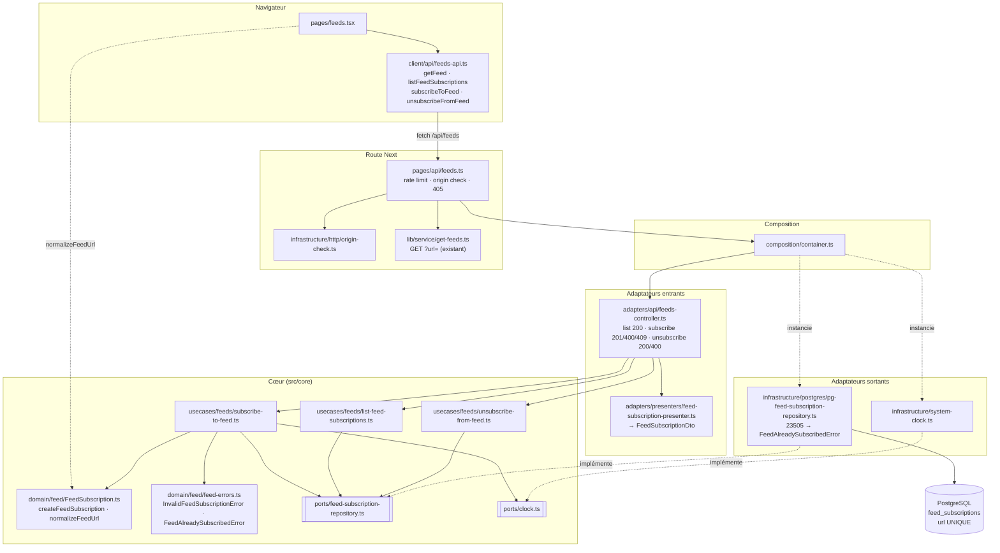
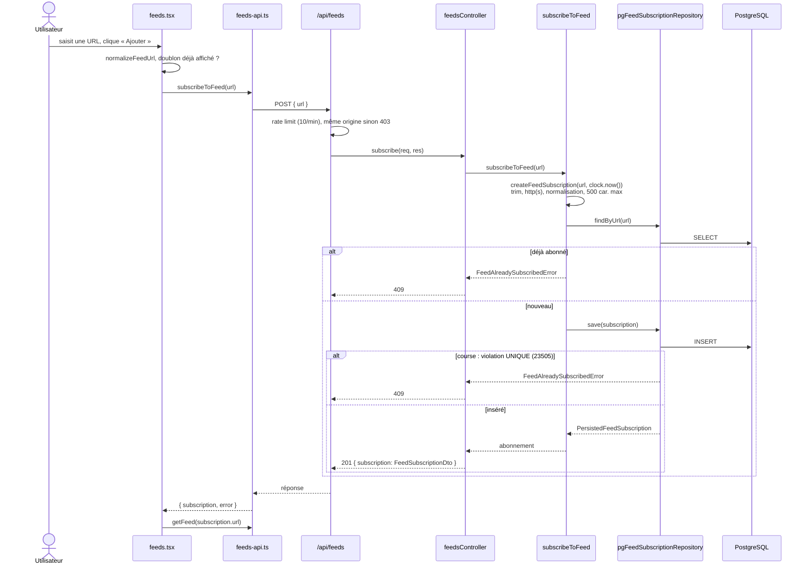

# Plan — Enregistrer les flux RSS en base (première tranche en architecture cible)

## Contexte

Aujourd'hui, les URLs des flux de la page `/feeds` sont stockées dans le `localStorage` du navigateur (clé `rss-feed-urls`, `src/pages/feeds.tsx`) : elles sont propres à un navigateur, ne suivent pas d'un appareil à l'autre et disparaissent si on vide les données du site. Objectif : les enregistrer dans PostgreSQL et les gérer via `/api/feeds` (lister, ajouter, supprimer).

Le code neuf suit `documentation/architecture-cible.md` (Clean Architecture : entités → ports → use cases → adaptateurs → composition → route Next minimale). Les flux deviennent la **première tranche verticale** dans la nouvelle arborescence. On ne déplace pas les gloses ni les personnes, et l'existant non concerné n'est pas touché.

## Décisions

- **Entité `FeedSubscription`** (un abonnement : `id`, `url`, `createdAt`), distincte de `Feed` (le contenu parsé d'un flux). Table dédiée `feed_subscriptions` avec `url` `NOT NULL UNIQUE`. La table `urls`, inutilisée, n'est pas touchée.
- **Une seule route `/api/feeds`** :
    - `GET` sans paramètre : liste les abonnements ;
    - `GET ?url=` : contenu du flux, comportement inchangé ;
    - `POST` : abonnement, avec contrôle d'origine ;
    - `DELETE ?id=` : désabonnement, avec contrôle d'origine.
- **Doublons** : le use case refuse une URL déjà enregistrée (erreur `FeedAlreadySubscribedError`, réponse 409). La contrainte `UNIQUE` sert de filet de sécurité.
- **`localStorage` abandonné** : la page ne lit plus que l'API. Les flux déjà enregistrés dans le navigateur sont à rajouter à la main.
- **Client HTTP** : création de `src/client/api/feeds-api.ts` comme le prévoit la cible. `getFeed` y est déplacé depuis `src/actions/feeds-actions.ts`, qui est supprimé avec son test déplacé.
- **SQL** : les requêtes vont dans `infra/database/sql_queries.ts`, et l'adaptateur réutilise `infra/database/connectionPool.ts`. Le déplacement de ces fichiers est l'étape 3 de la migration, hors périmètre.
- **Hors périmètre** :
    - garde SSRF, timeout et taille maximale du lecteur RSS (`http-feed-reader.ts` de la cible) ;
    - passage de `get-feeds.ts` vers `parse-feed.ts` et le port `FeedReader` ;
    - migration des gloses et des personnes.

## Architecture

Les flèches pleines sont des appels ou des imports. Elles vont toujours vers le cœur (`src/core`), qui ne dépend de rien d'extérieur. Les flèches pointillées vont d'un adaptateur au port qu'il implémente. `container.ts` est le seul fichier qui instancie les adaptateurs et les injecte dans les use cases.

### Abonnement à un flux (`POST /api/feeds`)

## Étapes (TDD : test rouge → code → vert)

- [x] 0. Copier ce plan dans `plans/feed-subscriptions.md`
- [x] 1. **Base** : ajouter à `infra/database/scripts/migrations.sql` :
      `CREATE TABLE IF NOT EXISTS feed_subscriptions (id SERIAL PRIMARY KEY, url VARCHAR(500) NOT NULL UNIQUE, created_at TIMESTAMP WITH TIME ZONE NOT NULL)`.
      Ajouter `INSERT_FEED_SUBSCRIPTION`, `SELECT_ALL_FEED_SUBSCRIPTIONS`, `SELECT_FEED_SUBSCRIPTION_BY_URL` et `DELETE_FEED_SUBSCRIPTION` à `infra/database/sql_queries.ts`, avec des tests dans `__tests__/infra/database/sql_queries.test.ts` (testcontainers).
- [x] 2. **Entité** `src/core/domain/feed/FeedSubscription.ts` : type, `createFeedSubscription(url, now)` (trim, seuls `http:`/`https:` acceptés, sinon `InvalidFeedSubscriptionError`). Erreurs dans `src/core/domain/feed/feed-errors.ts`. Tests purs, sans mock.
- [x] 3. **Ports** `src/core/ports/` :
    - `feed-subscription-repository.ts` : `save`, `findAll`, `findByUrl`, `delete(id)` ;
    - `clock.ts` : `now(): Date`, réutilisable ensuite par les gloses.
- [x] 4. **Use cases** `src/core/usecases/feeds/` : `subscribe-to-feed.ts` (refuse un doublon), `list-feed-subscriptions.ts`, `unsubscribe-from-feed.ts`. Injection de dépendances comme dans la cible : `({ repo, clock }) => async (input) => …`. Ils sont testés avec un faux repository en mémoire (`__tests__/fakes/in-memory-feed-subscription-repository.ts`) et une horloge fixe, sans `vi.mock` de module.
- [x] 5. **Adaptateurs sortants** :
    - `src/infrastructure/postgres/pg-feed-subscription-repository.ts` : implémente le port et convertit chaque ligne (`created_at`) en entité (`createdAt: Date`) ;
    - `src/infrastructure/system-clock.ts`.

    Le test du repository tourne contre un vrai Postgres (testcontainers, sur le modèle de `__tests__/infra/database/sql_queries.test.ts`). Il faut l'ajouter à l'`include` de `vitest.config.db.mts` et l'exclure de `vitest.config.mts`.

- [x] 6. **Contrôle d'origine** : extraire `isValidOrigin` dans `src/infrastructure/http/origin-check.ts`, avec ses tests, et l'utiliser dans la route feeds. `people.ts` et `gloses.ts` garderont leur copie jusqu'à leur propre migration.
- [x] 7. **Contrôleur et presenter** :
    - `src/adapters/presenters/feed-subscription-presenter.ts` : `toFeedSubscriptionDto` → `{ id, url, createdAt: ISO }` ;
    - `src/adapters/api/feeds-controller.ts` : `list` (200), `subscribe` (201 ; 400 si le body ou l'URL sont invalides ; 409 si doublon ; 500 sinon), `unsubscribe` (200 ; 400 si l'id est invalide).

    Les tests utilisent des stubs des use cases et `createMockApiResponse` (`__tests__/test-helpers.ts`).

- [x] 8. **Composition** `src/composition/container.ts` : instancie le repository pg, l'horloge, les use cases et `feedsController`. C'est le seul endroit qui instancie les adaptateurs.
- [x] 9. **Route** `src/pages/api/feeds.ts` :
    - rate limit et chemin `GET ?url=` inchangés ;
    - `GET` sans `url` délègue à `container.feedsController.list` ;
    - `POST` et `DELETE` passent par `origin-check` puis délèguent au contrôleur ;
    - toute autre méthode renvoie 405.

    Mettre à jour `__tests__/src/api/feeds.test.ts`.

- [x] 10. **Client HTTP** `src/client/api/feeds-api.ts` : `getFeed` (déplacé), `listFeedSubscriptions`, `subscribeToFeed(url)`, `unsubscribeFromFeed(id)`, tous via `httpClient`. Déplacer et compléter le test (`__tests__/src/client/api/feeds-api.test.ts`), puis supprimer `src/actions/feeds-actions.ts` et son test.
- [x] 11. **Page** `src/pages/feeds.tsx` :
    - le state passe de `string[]` à `{ id, url }[]` ;
    - au montage, la page charge la liste, puis le contenu de chaque flux ;
    - l'ajout appelle `subscribeToFeed` puis `loadFeed`. La page détecte elle-même les doublons à partir de la liste chargée et affiche « Flux déjà ajouté : <url> », car `httpClient` ne transmet pas le code HTTP. Le 409 de l'API reste un filet de sécurité ;
    - la suppression appelle `unsubscribeFromFeed(id)` ;
    - le `localStorage` est retiré.

    Réécrire les tests `localStorage` de `__tests__/src/pages/feeds.test.tsx` en mockant `feeds-api`.

- [x] 12. **Documentation** : dans `CLAUDE.md`, indiquer que le code neuf suit `documentation/architecture-cible.md` et que les flux en sont la première tranche. Dans `documentation/plan.md`, noter l'avancement du point 10.
- [x] 13. `npm run type-check`, `npm run lint`, `npm run test`, `npm run test:db`
- [x] 14. **Vérification de bout en bout** (`/verify`) :
    1. appliquer `migrations.sql` sur la base de dev (`npm run database:migrations`) ;
    2. avec `npm run dev`, ajouter un flux depuis `/feeds` puis recharger la page : il est toujours là ;
    3. ouvrir la page dans un autre navigateur ou en navigation privée : le flux est là aussi ;
    4. ajouter la même URL : message de doublon ;
    5. supprimer le flux : il disparaît de la table `feed_subscriptions` (vérifier avec psql) ;
    6. côté API : `POST` sans `Origin` → 403, `DELETE ?id=abc` → 400, `PUT` → 405.

## Fichiers

**Créés** :

- `src/core/domain/feed/{FeedSubscription,feed-errors}.ts`
- `src/core/ports/{feed-subscription-repository,clock}.ts`
- `src/core/usecases/feeds/*.ts`
- `src/infrastructure/{postgres/pg-feed-subscription-repository,http/origin-check,system-clock}.ts`
- `src/adapters/{api/feeds-controller,presenters/feed-subscription-presenter}.ts`
- `src/composition/container.ts`
- `src/client/api/feeds-api.ts`
- les tests miroirs sous `__tests__/src/…` et `__tests__/fakes/…`

**Modifiés** : `infra/database/scripts/migrations.sql`, `infra/database/sql_queries.ts`, `src/pages/api/feeds.ts`, `src/pages/feeds.tsx`, `vitest.config.mts`, `vitest.config.db.mts`, `CLAUDE.md`, `documentation/plan.md`

**Supprimés** : `src/actions/feeds-actions.ts` et son test

## Constat pendant la vérification

Le rate limiter (`src/lib/rate-limiter.ts`) garde **un seul compteur par IP**, partagé entre toutes les méthodes et toutes les routes. Les GET comptent donc dans la limite de 10 écritures par minute. En dev, React StrictMode double les appels du montage : ouvrir `/feeds` deux ou trois fois avec un flux suffit à faire répondre 429 au `POST` ou au `DELETE` suivant. La page affiche alors son message d'erreur. Le problème existe aussi pour `people` et `gloses`. Correctif proposé, hors de ce plan : une clé par IP et par type de limite (`${ip}:read` / `${ip}:write`).
